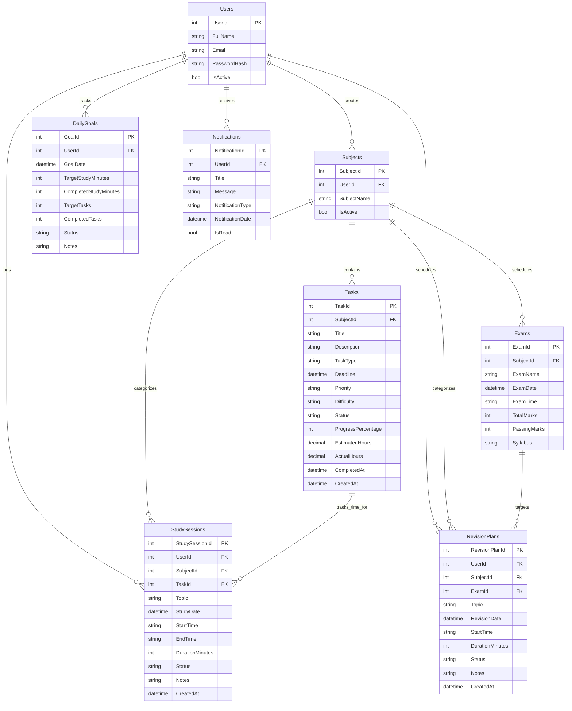

# 🎓 Smart Study Planner
> **Academic Project for .NET / Dotnet Subject**  
> Built with **ASP.NET Core 8.0 MVC**, **Entity Framework Core**, **Bootstrap 5**, **Chart.js**, and **FullCalendar**.

---

## 🌟 Overview & Objectives
**Smart Study Planner** is a full-featured web application designed to help university and college students organize their academic life. Instead of juggling separate calendar apps, reminder alarms, physical diaries, and to-do lists, this system brings all study essentials into one cohesive, automated platform.

### Target Audience
* College & University Students
* Competitive Examination Aspirants (GATE, GRE, UPSC, etc.)
* Engineering & Computer Science Majors

---

## 💻 Tech Stack & Architecture
* **Framework**: ASP.NET Core 8.0 (Model-View-Controller)
* **ORM**: Entity Framework Core 8.0 (Code-First & Database-First compatible)
* **Cross-Platform & Multi-Database Engine**:
  * **SQLite** (Default — Zero-configuration, runs natively on macOS, Linux, and Windows)
  * **Microsoft SQL Server** (Supported via `appsettings.json` and bundled T-SQL scripts for Windows/SSMS evaluation)
  * **MongoDB Atlas NoSQL Cloud Database** (Integrated via `MongoDB.Driver` 3.13 with live cluster health monitoring and two-way sync for all 8 modules)
* **Security & Auth**:
  * Cookie-based Authentication (`CookieAuthenticationDefaults`)
  * Cryptographic Password Hashing via `BCrypt.Net-Next` (Salted PBKDF/Blowfish)
* **Frontend & Visualization**:
  * Bootstrap 5.3 & Bootstrap Icons
  * Chart.js (Weekly study trends & subject distribution doughnut)
  * FullCalendar 6.1 (Interactive monthly & weekly timetable)
* **Architecture Pattern**:
  * Clean MVC with Separation of Concerns
  * Dependency Injection for `ApplicationDbContext` and `INotificationService`
  * Asynchronous asynchronous programming (`async` / `await`) across all controllers

---

## 🗄️ Database Schema (Exact 8-Table Structure)



---

## 🚀 How to Run the Project

### 1. Prerequisites
* [.NET 8.0 SDK](https://dotnet.microsoft.com/download) installed.

### 2. Run the Application
In your terminal, navigate to the project directory and run:

```bash
dotnet run --launch-profile http
```

Open your browser and navigate to:
👉 **`http://localhost:5186`**

### 3. Pre-Seeded Demo Student Account
The database is **automatically created and seeded** on the very first run! You can immediately sign in with the demo account:

* **Email**: `student@study.edu`
* **Password**: `Password123!`

*(You can also click the green **"One-Click Demo Student Sign In"** button on the home page).*

---

## 🎛️ Switching to Microsoft SQL Server (Optional)
If your professor or college lab requires Microsoft SQL Server:
1. Open `appsettings.json`.
2. Change `"DatabaseProvider": "Sqlite"` to `"DatabaseProvider": "SqlServer"`.
3. Update the `"SqlServerConnection"` string to point to your SQL Server / LocalDB instance.
4. Pre-written SQL scripts are available in the `Database/` folder:
   * `Database/Schema_SqlServer.sql` (Complete T-SQL DDL script)
   * `Database/SeedData.sql` (Sample data insertions)

---

## 🍃 MongoDB Atlas Cloud Integration
The project connects to **MongoDB Atlas** (`cluster0.mio42uj.mongodb.net`) for hybrid NoSQL cloud backup, disaster recovery, and document-oriented queries:
* **Configuration**: Configured in `appsettings.json` under `ConnectionStrings:MongoDbConnection` and `MongoDbDatabaseName`.
* **Live Cluster Dashboard**: Access **`http://localhost:5186/DatabaseStatus`** (or click **Cloud DB** in the top navigation).
* **One-Click Sync**: Push all 8 relational tables (Users, Subjects, Tasks, Exams, Sessions, Revisions, Goals, Notifications) into MongoDB collections with 1 click.
* **Health Checks**: Real-time ping latency check directly to the MongoDB Atlas replica set.

---

## 📋 Features Implemented (Matching All Schema Tables)

| Module | Core Functionality | Schema Table |
| :--- | :--- | :--- |
| 👤 **Authentication & Profile** | Registration, Login with BCrypt, Session Claims, Profile stats. | `Users` |
| 📚 **Subject Management** | Full CRUD for academic courses with active/archived status. | `Subjects` |
| 📝 **Tasks & Assignments** | Priority, Difficulty, Progress %, Est vs Act Hours, status toggle. | `Tasks` |
| 🎯 **Exam Countdown** | Live countdown timer, marks criteria, and syllabus drawer. | `Exams` |
| ⏱️ **Study Sessions** | Focused time logger by topic and task with real-time goal sync. | `StudySessions` |
| 🔄 **Revision Planner** | Spaced repetition scheduler linked to upcoming exams. | `RevisionPlans` |
| 🎯 **Daily Goals** | Target study time vs completed minutes & task completion bars. | `DailyGoals` |
| 🔔 **Notifications Engine** | Automatic triggers for exams (within 14d) and tasks (within 3d). | `Notifications` |
| 📅 **Interactive Calendar** | FullCalendar monthly view uniting exams, tasks, study & revision. | Combined API |
| 📊 **Progress Dashboard** | Chart.js weekly study trends & subject distribution doughnut. | ViewModels |

---

## 💡 Viva / Faculty Review Q&A Points
* **Why MVC?**: Provides clean separation of concerns: Model (Entities/Data), View (Razor UI), Controller (Business Logic & Routing).
* **Why EF Core Code-First?**: Eliminates repetitive boilerplate ADO.NET SQL code, provides type safety, and enables automatic migrations.
* **How are Passwords Stored?**: Hashed using BCrypt with a secure workload factor (salt). Plaintext passwords are never stored.
* **How are Relationships Managed?**: Configured in `ApplicationDbContext` via Fluent API, using `OnDelete(DeleteBehavior.Restrict)` to prevent SQL Server cascade cycle exceptions.

